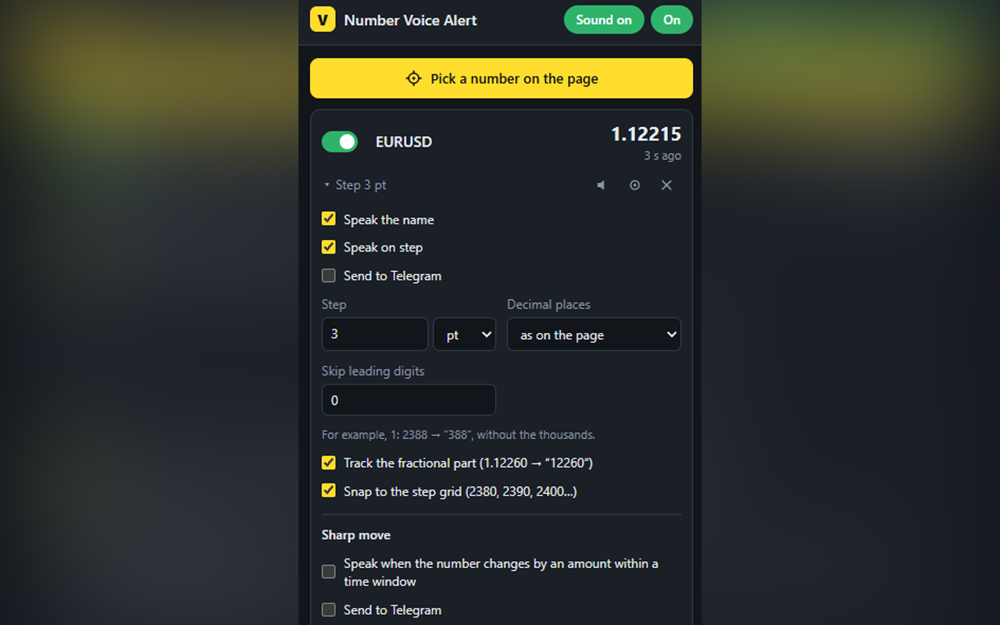

# Number Voice Alert

A Chrome extension that watches any number on a web page — a price, an index, a rate, a counter —
and tells you when it changes: by voice and, optionally, in Telegram.

Pick the number with a click, set a step, and keep working in other windows: the extension speaks
“Index 2390” when the value moves by the step, or “Up 2 percent in 5 minutes” on a sharp move.



## Features

- **Pick any number on any site.** Hover, click, done. The selector is built automatically and survives
  most page re-renders; arrow keys move the selection to the parent/child element.
- **Step alerts.** Speak the value whenever it moves by N points or N percent, optionally snapped
  to round levels (2380, 2390, 2400…), with a cooldown between phrases.
- **Sharp move alerts.** Speak when the value rises or falls by N points/percent within a time window.
- **Telegram notifications.** Each alert type can go to voice, Telegram or both. Telegram keeps working
  while the sound is muted.
- **Voices.** Any voice installed in the system or provided by the browser. The list shows up to two voices
  (female and male where possible) for ten popular languages.
- **Phrase template.** `{name} {value}`, `{dir}` (up/down), `{delta}` (change).
- **Short phrases.** Skip the fractional part or the leading digits that rarely change,
  or track only the fraction for quotes like 1.12260: the voice says “12260”, steps in points count
  in units of the last digit (3 = 0.00003), Telegram still gets the full number.
- **Reminders.** Repeat the current values every N minutes.
- **Warnings** when the watched element disappears or its tab is closed.
- **Hotkeys** for mute, on/off and “speak now” (assigned at `chrome://extensions/shortcuts`).
- **Languages:** English and Russian interface. Spoken phrases are in Russian with Russian voices
  and in English with all other voices.

## Installation

### From source

1. Download or clone this repository.
2. Open `chrome://extensions` and turn on **Developer mode**.
3. Click **Load unpacked** and select the repository folder (the one with `manifest.json`).

Works in Chrome and Chromium-based browsers (Edge, Yandex Browser, Brave, Opera).

### Packaging for the Chrome Web Store

```
bun tools/build-dist.ts
```

The script copies only the runtime files (`manifest.json`, `_locales`, `icons`, `src`, `LICENSE`)
into `dist/` and checks that every file the manifest refers to is there. Zip the **contents**
of `dist/` (so `manifest.json` is at the archive root) and upload the archive in the developer dashboard.

## Usage

1. Open the page with the number.
2. Click the extension icon → **Pick a number on the page**, then click the number.
3. Give it a name (it is spoken before the value) and a step, press **Save**.
4. Fine-tune the step, sharp move and Telegram options in the card of that number in the popup.

### Voices

Windows: *Settings → Time & language → Speech → Add voices* installs more voices. Restart the browser
afterwards so it picks them up. Online (Google) voices need a network connection; installed voices
are preferred when both exist.

### Telegram

1. Create a bot with [@BotFather](https://t.me/BotFather) and paste its token into the popup.
2. Send the bot any message and press **Find chat_id**.
3. Press **Send test** to check the setup, then enable **Send to Telegram** for the alerts you need.

## Privacy

- Settings, watched elements, the bot token and chat_id are stored locally in the browser
  (`chrome.storage.local`). They are not synced and not sent anywhere else.
- The extension sends data only to `api.telegram.org`, and only when Telegram is configured:
  the alert text goes to the chat you chose.
- No analytics, no tracking, no remote code.

### Why these permissions

| Permission | Reason |
| --- | --- |
| `<all_urls>`, `scripting` | Read the chosen number on any site you pick it on |
| `tts` | Speak alerts |
| `storage` | Keep settings and the list of watched numbers |
| `alarms` | Periodic reminders |
| `activeTab` | Start the element picker on the current tab |

## Project structure

```
manifest.json
icons/               Extension icons, 16–128 px
docs/                Screenshots for the README
_locales/            Manifest strings (name, description, hotkeys) in en/ru
src/
  shared/
    i18n.js          Interface strings and language selection
    common.js        Settings, storage, number parsing and formatting
    speech.js        Spoken phrases per language, voice list, chrome.tts wrapper
    telegram.js      Telegram Bot API client
  background/
    service-worker.js  Alert logic: steps, cooldowns, reminders, hotkeys
    move-alert.js      Sharp move detection
  content/
    picker.js        On-page element picker
    content.js       Tracks watched elements and reports values
  popup/             Settings UI
tools/
  render-icons.py    Icon generator
  build-dist.ts      Assembles dist/ for the store (Bun)
```

No bundler and no dependencies: plain JavaScript loaded directly by the browser.
`tools/render-icons.py` regenerates the icons (needs Pillow and Windows fonts).

## License

[MIT](LICENSE)
